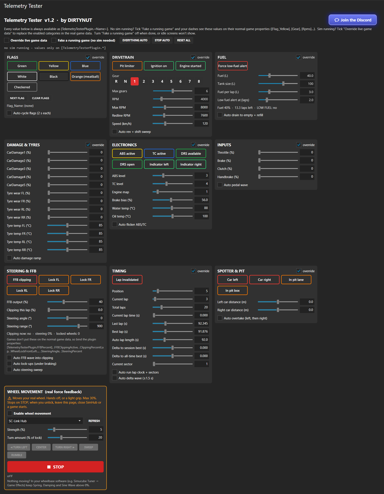

# Telemetry Tester for SimHub

**By DIRTYNUT** · v1.2

  

<h2 align="center"><a href="https://discord.gg/TwagTfRfvJ">👉 Join the DIRTYNUT Discord 👈</a></h2>

---

A SimHub plugin for testing dashes and LED profiles without driving. Flip flags, change gears, rev the engine, drain the fuel, damage the car, fake FFB clipping and lock-ups, and fake a car alongside you – all from a control panel inside SimHub. It can even move your real wheel.

## Screenshot

  

## Download
Telemetry Tester is **free** and available exclusively on the **DIRTYNUT Discord**. Click the banner above, then grab it from **#releases**. You'll also get setup help, new dashes, and a chance to earn the Crew role for early test builds.

## Install
1. Close SimHub.
2. Copy `DirtySim.TelemetryTester.dll` into your SimHub folder (usually `C:\Program Files (x86)\SimHub`).
3. Start SimHub. If asked, enable the plugin. It shows up in the left menu as **Telemetry Tester**.

## What you can fake
| Category | Values |
|---|---|
| Flags | Green, Yellow, Blue, White, Black, Orange, Checkered · auto-cycle |
| Drivetrain | Gear R/N/1–8, RPM, max RPM, redline, speed, pit limiter, ignition · auto rev & shift sweep |
| Fuel | Fuel, tank size, fuel per lap, low-fuel alert · auto drain & refill |
| Damage & Tyres | CarDamage1–5, tyre wear and temps per corner · auto ramp |
| Electronics | ABS/TC active & level, engine map, brake bias, DRS, water/oil temp, indicators |
| Inputs | Throttle, brake, clutch, handbrake · auto pedal wave |
| Steering & FFB | FFB %, clipping, clipping % lap, wheel lock per corner, steering angle · auto FFB wave, lock-ups & sweep |
| Timing | Position, laps, current/last/best lap, sectors, track position, deltas, lap invalid · auto lap clock & delta |
| Spotter & Pit | Car left/right + distance, pit lane, pit box · auto overtake |

## How to use it
**Fake a running game** – no sim needed. Tick it and SimHub behaves as if a game is running, with all the tester values on the normal game properties (`Flag_Yellow`, `Gear`, `Rpms`, `SpotterCarLeft`…), so your dashes react with their normal bindings. It's off every time SimHub starts – turn it off when you're done, otherwise idle screens won't show.

**Override live game data** – with a sim (or a SimHub replay) running, tick it to replace the real values with the tester's. Each category can be included or left live.

**Plugin properties** – every value is also always available as `[TelemetryTesterPlugin.<Name>]`, e.g. `[TelemetryTesterPlugin.Flag_Yellow]`, `[TelemetryTesterPlugin.Gear]`, `[TelemetryTesterPlugin.LowFuelAlert]`. Steering & FFB values are only on the plugin properties: `FFBPercent`, `FFBClippingActive`, `ClippingPercentLap`, `WheelLockFrontLeft`…, `SteeringAngle`, `SteeringPercent`.

## Wheel movement (real force feedback)
⚠️ Moves your real wheel – **turn left/right, center, sweep, rumble** and a big red **STOP**. Starts at 5% strength, capped at 30%, every effect fades in, and it stops and releases the wheel when a game starts, you leave the page or close SimHub. A safety warning must be accepted each session. Tested on a Simucube 3 Pro. If nothing moves, make sure your wheelbase software's game effects (Spring / Damping / Sine) aren't at 0%. **Use at your own risk.**

## Mappable actions
`CycleFlag` · `ClearFlags` · `GearUp` · `GearDown` · `ToggleYellow` · `ToggleBlue` · `ToggleLowFuel` · `ToggleOverride` · `ToggleFakeGame` · `ToggleClipping` · `WheelStop` · `ResetAll`

## License
Copyright © 2026 DIRTYNUT. All rights reserved. Copying, redistribution, modified versions and competing products are not permitted. See [LICENSE](LICENSE).
