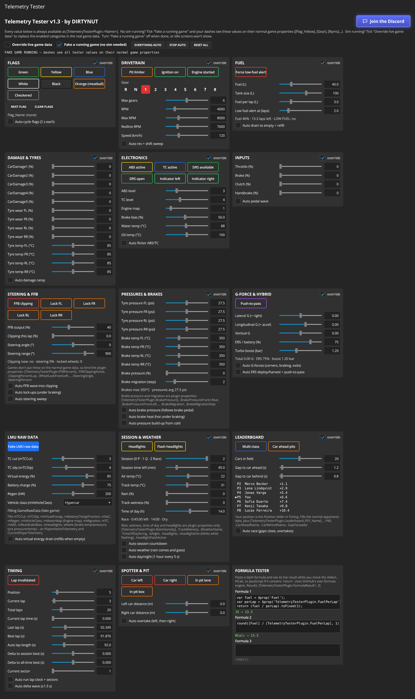

# Telemetry Tester for SimHub

**By DIRTYNUT** · v1.3

  

<h2 align="center"><a href="https://discord.gg/TwagTfRfvJ">👉 Join the DIRTYNUT Discord 👈</a></h2>

---

A SimHub plugin for testing dashes and LED profiles without driving. Flip flags, change gears, rev the engine, drain the fuel, damage the car, fake FFB clipping and lock-ups, fake a full leaderboard, weather, night and headlights, fake Le Mans Ultimate's raw data, test your own formulas, and fake a car alongside you – all from a control panel inside SimHub.

## Screenshot

  

## Download
Telemetry Tester is **free** and available exclusively on the **DIRTYNUT Discord**. Click the banner above, then grab it from **#releases**. You'll also get setup help, new dashes, and a chance to earn the Crew role for early test builds.

## Install
1. Close SimHub.
2. Copy `DirtySim.TelemetryTester.dll` into your SimHub folder (usually `C:\Program Files (x86)\SimHub`).
3. Start SimHub. If asked, enable the plugin. It shows up in the left menu as **Telemetry Tester**.

## What you can fake
| Category | Values |
|---|---|
| Flags | Green, Yellow, Blue, White, Black, Orange, Checkered · auto-cycle |
| Drivetrain | Gear R/N/1–8, RPM, max RPM, redline, speed, pit limiter, ignition · auto rev & shift sweep |
| Fuel | Fuel, tank size, fuel per lap, low-fuel alert · auto drain & refill |
| Damage & Tyres | CarDamage1–5, tyre wear and temps per corner · auto ramp |
| Electronics | ABS/TC active & level, engine map, brake bias, DRS, water/oil temp, indicators |
| Inputs | Throttle, brake, clutch, handbrake · auto pedal wave |
| Steering & FFB | FFB %, clipping, clipping % lap, wheel lock per corner, steering angle · auto FFB wave, lock-ups & sweep |
| Pressures & Brakes | Tyre pressures, brake temps per corner, brake pressure (front/rear split by bias), brake migration · auto brake pressure, brake heat & pressure build |
| G-Force & Hybrid | Lateral/longitudinal/vertical G, ERS / battery, turbo boost, push-to-pass · auto G-forces & ERS deploy |
| Session & Weather | Session type, time left, air/track temp, rain, track wetness, time of day, **headlights, flashing headlights** · auto countdown, weather & day/night |
| LMU Raw Data | TC cut, TC slip, virtual energy, battery charge, regen, vehicle class on `GameRawData` · auto virtual energy drain |
| Leaderboard | Fake field up to 40 cars, multi-class, gaps ahead/behind, car ahead in pit · auto race battles |
| Timing | Position, laps, current/last/best lap, sectors, track position, deltas, lap invalid · auto lap clock & delta |
| Spotter & Pit | Car left/right + distance, pit lane, pit box · auto overtake |

## How to use it
**Fake a running game** – no sim needed. Tick it and SimHub behaves as if a game is running, with all the tester values on the normal game properties (`Flag_Yellow`, `Gear`, `Rpms`, `SpotterCarLeft`…), so your dashes react with their normal bindings. It's off every time SimHub starts – turn it off when you're done, otherwise idle screens won't show.

**Override live game data** – with a sim (or a SimHub replay) running, tick it to replace the real values with the tester's. Each category can be included or left live.

**Plugin properties** – every value is also always available as `[TelemetryTesterPlugin.<Name>]`, e.g. `[TelemetryTesterPlugin.Flag_Yellow]`, `[TelemetryTesterPlugin.Gear]`, `[TelemetryTesterPlugin.LowFuelAlert]`. Steering & FFB values are only on the plugin properties: `FFBPercent`, `FFBClippingActive`, `ClippingPercentLap`, `WheelLockFrontLeft`…, `SteeringAngle`, `SteeringPercent`.

**Headlights** – `[TelemetryTesterPlugin.Headlights]` is the switch, `HeadlightsOn` is what your dash should show (it blinks on/off while flashing), and `HeadlightFlashActive` is 1 during a flash. Tick **Flash headlights** to flash continuously, or map `FlashHeadlights` to a button for a quick 3-flash.

## LMU raw data (GameRawData)
Tick **Fake LMU raw data** to fill Le Mans Ultimate's own raw properties, so dashes that read `[GameRawData.PlayerNativeTelemetry.*]` / `[GameRawData.CurrentPlayerTelemetry.*]` work without the game: TC cut, TC slip, virtual energy, battery charge, regen, brake migration, engine map, brake bias, headlights, brake/tyre temps and pressures – and a **vehicle class** box (Hypercar, LMP2, LMP3, GTE, GT3…) to test widgets that show or hide per class. Works with **Fake a running game**, or with **Override** while LMU is running.

## Formula tester
Paste up to 3 of your own dash formulas (NCalc, or JavaScript if it uses `return`) – e.g. your "laps remaining on current fuel" calculation – and see the live result while you move the sliders. It runs on SimHub's own formula engine, so the result matches what your dash would show, and errors are shown in red. Formulas are saved between SimHub sessions. Results are also on `[TelemetryTesterPlugin.FormulaResult1]`…`3`.

## Wheel movement – paused
The real wheel movement from v1.2 has been **removed in this version** to make room for more telemetry data. Based on your feedback, the extra data is far more useful for testing dashes than moving the wheel. It will come back in a future release. The Steering & FFB dash values (clipping, lock-ups, steering angle) are still here – they only fake numbers and don't move anything.

## Mappable actions
`CycleFlag` · `ClearFlags` · `GearUp` · `GearDown` · `ToggleYellow` · `ToggleBlue` · `ToggleLowFuel` · `ToggleOverride` · `ToggleFakeGame` · `ToggleClipping` · `PositionUp` · `PositionDown` · `ToggleRain` · `ToggleHeadlights` · `FlashHeadlights` · `ResetAll`

## License
Copyright © 2026 DIRTYNUT. All rights reserved. Copying, redistribution, modified versions and competing products are not permitted. See [LICENSE](LICENSE).
